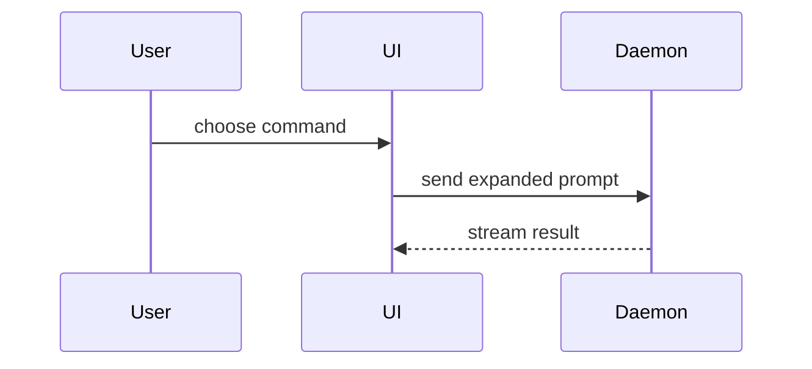

> Public-edition adaptation: runtime and personal-context guidance has been made portable; upstream attribution is retained.

# Show Me

Show the current topic visually. Skip the preamble and keep prose brief. Pick
the smallest view that makes the key point clear.

- Show logic or an algorithm as pseudocode:

```text
on(save)
  if content is unchanged
    return cached result
  write new content
  return fresh result
```

- Show runtime control flow as a call tree:

```text
submitForm
  createSession
    persistPrompt
    launchAgent
  navigateToSession
```

- Show UI structure as a component tree, including state and module
  boundaries that matter:

```tsx
<SessionPage> (apps/example/src/routes/session.tsx)
  useSessionEvents()
  <SessionToolbar>
    <RunSkillButton> (packages/ui)
```

- Show file responsibility or a broad refactor as a shallow file tree:

```text
src/
├── commands/       # parses user actions
├── sessions/       # owns session state
└── transport/      # sends API requests
```

- Show component interaction, control flow, or data flow with Mermaid:



- Use `diff` when the point is what changes and the surrounding shape already
  exists. Match the diff shape to the topic (component tree, file layout,
  call tree, or control flow, as illustrated above).

- Show the whole block when most of it is new, when omitted context would
  hide ownership or order, or when the user needs a copyable target shape.

- For a visual UI, layout, state comparison, or concept too dense for
  Mermaid, build one focused HTML artifact — a diagram, an infographic, or a
  short slide deck, whichever fits the point — using real labels and data.
  Use an available artifact surface when it fits the requested delivery. Load
  its design skill only if that capability is actually available and required.
  Otherwise write a self-contained HTML file in the session artifact location
  (or temporary directory for a transient visual) and link it in the reply.
  Use inline Mermaid when it fully explains the point. Do not install a missing
  tool or publish externally merely to satisfy this workflow.

## Guidance

Place each visual next to the short text it supports. Keep only the calls,
files, props, states, and boundaries needed to answer the user's current
question or the options on the table.

Use one of these views, or a few — it is unlikely you'll need all of them.
Use judgment; don't overwhelm the reader with every format at once.

## Exit criterion

Done when the topic has one or more focused visuals placed next to brief
supporting prose (or a working artifact/file link for HTML),
and the reply doesn't restate in prose what the visual already shows.

## Source

Ported from HumanLayer's `show-me` skill
(`humanlayer/skills`, `plugins/show-me/skills/show-me/SKILL.md`), from
[Dex Horthy's tweet](https://x.com/dexhorthy/status/2087569590268391897).
Adapted for multiple runtimes: delivery uses the available artifact surface,
a local HTML file, or an inline diagram.
